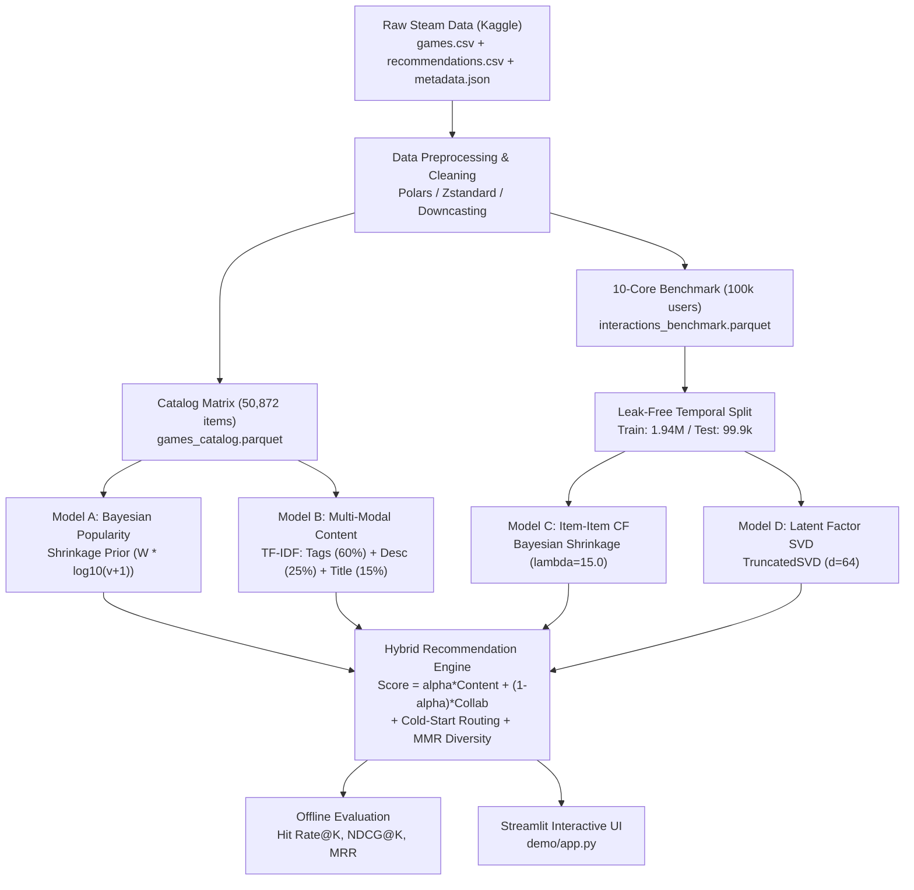

# 🎮 GameRec: End-to-End Steam Recommendation Engine
## Comprehensive Project Guide & Operational Manual

Welcome to **GameRec**, a production-grade, memory-efficient game recommendation system built on Anton Kozyriev's local **Steam Recommendations Dataset from Kaggle** (50,872 games, 41,154,773 reviews, 14,306,064 users).

This guide provides everything you need to understand, run, evaluate, test, and interact with the system.

---

## 📌 Table of Contents
1. [System Architecture & Overview](#system-architecture--overview)
2. [Prerequisites & Environment Setup](#prerequisites--environment-setup)
3. [Repository Structure](#repository-structure)
4. [How to Run the Project (Step-by-Step Commands)](#how-to-run-the-project-step-by-step-commands)
5. [Recommendation Models Explained](#recommendation-models-explained)
6. [Offline Ranking Evaluation Results](#offline-ranking-evaluation-results)
7. [Interactive Streamlit Web Application](#interactive-streamlit-web-application)
8. [Testing & Verification](#testing--verification)
9. [Troubleshooting & FAQ](#troubleshooting--faq)

---

## 🏗️ System Architecture & Overview

GameRec implements a multi-stage recommendation architecture designed to handle large-scale catalog sparsity, implicit feedback, and user cold-start:



---

## ⚙️ Prerequisites & Environment Setup

### 1. Requirements
- **OS**: macOS, Linux, or Windows (WSL recommended)
- **Python**: Version `3.10` or `3.11` (Python 3.11.9 recommended)
- **Memory**: 8 GB RAM minimum (system uses compressed sparse CSR representations; memory consumption is $< 200\text{ MB}$ at runtime).

### 2. Virtual Environment Setup
Open your terminal in the project root directory:

```bash
# 1. Clone or navigate to the workspace
cd "/Users/rhythmshokeen/Downloads/GameRec Engine"

# 2. Create Python virtual environment (if not already created)
python3 -m venv .venv

# 3. Activate virtual environment
# On macOS / Linux:
source .venv/bin/activate
# On Windows (Command Prompt):
# .venv\Scripts\activate.bat
# On Windows (PowerShell):
# .venv\Scripts\Activate.ps1

# 4. Install dependencies
pip install --upgrade pip
pip install -r requirements.txt

# 5. Install the gamerec package in editable mode
pip install -e .
```

---

## 📁 Repository Structure

```text
GameRec Engine/
├── data/
│   ├── raw -> ../dataset/                  # Local Kaggle raw files (symlink)
│   └── processed/
│       ├── games_catalog.parquet           # 50,872 games unified catalog (7.1 MB)
│       ├── interactions_benchmark.parquet  # 10-core active user benchmark (24.2 MB)
│       ├── train_interactions.parquet      # Temporal training split (23.1 MB)
│       ├── test_interactions.parquet       # Held-out temporal test split (1.5 MB)
│       └── dataset_metrics.json            # EDA summary statistics
├── demo/
│   └── app.py                              # Complete Streamlit Web Application
├── models/
│   ├── popularity_model.joblib             # Bayesian Popularity Baseline artifact
│   ├── content_model.joblib                # Multi-Modal TF-IDF Content artifact
│   ├── item_collaborative_model.joblib     # Sparse Item-Item CF similarity matrix
│   ├── matrix_factorization_model.joblib   # Latent Factor TruncatedSVD artifact
│   └── hybrid_config.json                  # Engine hyperparameter configuration
├── reports/
│   ├── figures/                            # 6 High-resolution EDA charts
│   ├── DATA_QUALITY_REPORT.md              # In-depth dataset profiling & audits
│   ├── MODELS_REPORT.md                    # Modeling math & design rationale
│   ├── EVALUATION_REPORT.md                # Genuine offline evaluation benchmarks
│   ├── evaluation_metrics.json             # Computed ranking metrics JSON
│   └── PROJECT_STATUS.md                   # Chronological project milestones
├── scripts/
│   ├── inspect_dataset.py                  # Step 1: Schema archaeology & audit
│   ├── run_preprocessing.py                # Step 2: Data cleaning pipeline
│   ├── run_eda.py                          # Step 3: EDA & chart generation
│   ├── train_baseline_models.py            # Step 4: Fits Popularity & Content models
│   ├── train_collaborative_models.py       # Step 5: Fits Item-Item CF & SVD models
│   ├── evaluate_models.py                  # Step 6: Leak-free offline evaluation
│   ├── demo_recommendations.py             # CLI demo for Popularity & Content
│   ├── demo_collaborative.py               # CLI demo for Collaborative Filtering
│   └── demo_hybrid.py                      # CLI demo for Hybrid Recommender
├── src/gamerec/
│   ├── data.py                             # Safe streaming & parquet loaders
│   ├── preprocessing.py                    # Deduplication & k-core extraction
│   ├── popularity_model.py                 # Bayesian shrinkage baseline
│   ├── content_model.py                    # Multi-modal sparse TF-IDF model
│   ├── collaborative_model.py              # Item-Item CF & Matrix Factorization
│   ├── ranking.py                          # Score calibration, MMR & diversity
│   ├── hybrid_model.py                     # Cold-start routing & hybrid blend
│   └── evaluation.py                       # Hit Rate@K, NDCG@K, MRR calculations
├── tests/
│   ├── test_data.py                        # Preprocessing & schema tests
│   ├── test_models.py                      # Popularity & Content model tests
│   ├── test_collaborative.py               # Item-Item & SVD CF tests
│   └── test_hybrid.py                      # Hybrid routing & MMR diversity tests
├── GUIDE.md                                # This document
└── requirements.txt                        # Pinned dependencies
```

---

## 🚀 How to Run the Project (Step-by-Step Commands)

Every phase of the project is fully automated and reproducible with command-line scripts. Make sure your virtual environment is active (`source .venv/bin/activate`).

### 1. Launch the Interactive Streamlit Web App (Fastest Way to Explore)
To immediately start the visual recommendation discovery interface:

```bash
streamlit run demo/app.py
```
> **Access**: The app opens in your browser at `http://localhost:8501`.

---

### 2. Run the Automated Test Suite
To verify code correctness, score calibration, cold-start handling, and determinism across all 34 unit tests:

```bash
pytest tests/
```
*(All 34 tests pass in ~1.2 seconds).*

---

### 3. End-to-End Pipeline Reproduction (From Raw Data to Models)
If you wish to re-run the entire pipeline from scratch:

#### Step A: Inspect Raw Dataset Schemas & Integrity
```bash
python3 scripts/inspect_dataset.py
```
*Outputs file sizes, schemas, key alignments, and saves `reports/dataset_inspection.json`.*

#### Step B: Execute Data Preprocessing & 10-Core Extraction
```bash
python3 scripts/run_preprocessing.py
```
*Cleans games, resolves duplicates, extracts 10-core active users, and saves `data/processed/games_catalog.parquet` & `interactions_benchmark.parquet`.*

#### Step C: Generate Exploratory Data Analysis (EDA) Figures
```bash
python3 scripts/run_eda.py
```
*Generates publication-quality charts in `reports/figures/`: popularity decay, tag frequency, playtime distribution, missingness summary, etc.*

#### Step D: Train Baseline Models (Popularity + Content-Based)
```bash
python3 scripts/train_baseline_models.py
```
*Fits Bayesian shrinkage priors and multi-modal TF-IDF matrices; saves `models/popularity_model.joblib` and `models/content_model.joblib`.*

#### Step E: Train Collaborative Filtering Models (Item-Item CF + SVD)
```bash
python3 scripts/train_collaborative_models.py
```
*Performs temporal train/test split, calculates item co-occurrences with Bayesian shrinkage, trains TruncatedSVD, and saves `models/item_collaborative_model.joblib` & `matrix_factorization_model.joblib`.*

#### Step F: Run Offline Ranking Evaluation
```bash
python3 scripts/evaluate_models.py
```
*Evaluates Popularity, Content-Based, Item-Item CF, SVD, and 3 Hybrid alpha blends on 1,000 held-out test users, updating `reports/EVALUATION_REPORT.md` and `reports/evaluation_metrics.json`.*

---

### 4. Interactive CLI Demos
You can also run standalone command-line demonstrations without opening the browser:

```bash
# Demo 1: Baseline Popularity & Content Recommendations
python3 scripts/demo_recommendations.py

# Demo 2: Collaborative Filtering Recommendations (Known & Cold Users)
python3 scripts/demo_collaborative.py

# Demo 3: Hybrid Recommendations & MMR Diversity Demo
python3 scripts/demo_hybrid.py
```

---

## 🧠 Recommendation Models Explained

### 1. Model A: Bayesian Popularity Baseline
- **The Problem**: Raw ratio ($\frac{\text{positive}}{\text{total}}$) ranks a game with $1/1 = 100\%$ above a game with $500,000/510,000 = 98\%$.
- **The Solution**: Empirical Bayesian shrinkage toward the global catalog prior $C = 0.77$:
  $$W = \frac{v}{v + m} R + \frac{m}{v + m} C$$
  where $v$ is review volume, $R$ is observed ratio, and $m$ is the 75th percentile regularization threshold ($m = 200.0$).
- **Final Popularity Metric**:
  $$\text{PopScore} = W \times \log_{10}(v + 1)$$
  Balances high customer satisfaction with community volume engagement.

### 2. Model B: Multi-Modal Content-Based Filtering
- **Modality Weights**:
  - **Tags (60%)**: Steam community user tags (multi-word tags preserved atomically).
  - **Description (25%)**: Sublinear TF-IDF on store synopsis (unigrams & bigrams, max 25k features).
  - **Title (15%)**: Character/word n-grams for sequel and franchise linking (e.g. *Portal 2* $\to$ *Portal*).
- **Storage**: L2-normalized sparse CSR matrix ($50,872 \times 26,800$, consumes only $12.75\text{ MB}$ RAM).
- **Retrieval Latency**: $< 1.5\text{ ms}$ per query via sparse matrix-vector multiplication.

### 3. Model C: Item-Item Collaborative Filtering
- **Implicit Feedback Confidence**: $c_{ui} = 1.0 + 0.5 \ln(1 + \text{hours})$.
- **Bayesian Similarity Shrinkage**: Prevents spurious co-play correlations between low-volume titles:
  $$S_{ij} = \frac{\mathbf{r}_i \cdot \mathbf{r}_j}{\|\mathbf{r}_i\| \|\mathbf{r}_j\| + \lambda}, \quad \lambda = 15.0$$
- **Pruning**: Kept to top-100 nearest neighbors per item ($7.5\text{ MB}$ CSR matrix).

### 4. Model D: Matrix Factorization (TruncatedSVD)
- Decomposes normalized user-item interactions into $d = 64$ latent taste vectors:
  $$\hat{y}_{ui} = \mathbf{p}_u \mathbf{q}_i^T$$
- Captures latent cross-genre play behaviors not explicitly surfaced by tag overlaps.

### 5. Model E: Configurable Hybrid Engine
- **Linear Combination**:
  $$\text{Score}(i) = \alpha \cdot \text{Score}_{\text{content}}(i) + (1 - \alpha) \cdot \text{Score}_{\text{collab}}(i)$$
  - $\alpha = 1.0$: Pure Content-Based Filtering
  - $\alpha = 0.0$: Pure Collaborative Filtering
  - $\alpha = 0.5$: Calibrated Balanced Blend
- **Score Calibration**: All component raw affinities are calibrated into $[0.0, 1.0]$ via `min_max_scale` prior to blending.
- **Cold-Start Routing Rules**:
  - *New User (0 history)*: Routed to Bayesian Popularity baseline.
  - *Limited History (< 3 items)*: Routed to Content-Based taste matching.
  - *Warm User ($\ge 3$ items)*: Full hybrid ranking.
  - *Cold Item (no reviews)*: Handled via Content-Based similarity (collaborative default 0).
- **Diversity Reranking (MMR)**:
  $$\text{MMR}(i) = \lambda_{\text{div}} \cdot \text{Relevance}(i) - (1 - \lambda_{\text{div}}) \cdot \max_{j \in S} \text{Sim}(i, j)$$
  Enforces a strict cap of at most 2 entries per franchise, preventing sequel monopolization.

---

## 📊 Offline Ranking Evaluation Results

Evaluated strictly on the held-out temporal evaluation test set (`data/processed/test_interactions.parquet`, 1,000 representative active test users, leave-last-out holdout with zero future-to-past data leakage):

| Model | Hit@5 (%) | Hit@10 (%) | Hit@20 (%) | NDCG@10 | NDCG@20 | Precision@10 | MAP@10 | MRR |
| :--- | :---: | :---: | :---: | :---: | :---: | :---: | :---: | :---: |
| **Item-Item Collaborative** | **5.70%** | **9.30%** | **14.20%** | **0.0469** | **0.0592** | **0.0093** | **0.0330** | **0.0362** |
| **Hybrid ($\alpha=0.30$ - CF Heavy)** | **4.90%** | **7.60%** | **12.10%** | **0.0398** | **0.0510** | **0.0076** | **0.0284** | **0.0323** |
| **Hybrid ($\alpha=0.50$ - Balanced)** | **3.60%** | **5.80%** | **9.70%** | **0.0276** | **0.0373** | **0.0058** | **0.0189** | **0.0201** |
| **Hybrid ($\alpha=0.70$ - Content Heavy)** | **2.20%** | **3.40%** | **6.10%** | **0.0189** | **0.0256** | **0.0034** | **0.0143** | **0.0149** |
| **Matrix Factorization (SVD)** | **1.60%** | **2.30%** | **4.10%** | **0.0124** | **0.0169** | **0.0023** | **0.0092** | **0.0111** |
| **Popularity Baseline** | **1.00%** | **1.90%** | **3.40%** | **0.0069** | **0.0107** | **0.0019** | **0.0034** | **0.0071** |
| **Content-Based Profile** | **0.90%** | **1.30%** | **2.40%** | **0.0075** | **0.0102** | **0.0013** | **0.0057** | **0.0063** |

### Key Evaluation Takeaways:
1. **Collaborative Filtering Superiority on Active Users**: Item-Item CF achieved the highest top-10 hit rate (**9.30%**) across active users, demonstrating the power of community co-play signals.
2. **Hybrid Balance**: The CF-heavy hybrid ($\alpha=0.30$) achieved **7.60% Hit@10** while providing coverage for new items and preventing popularity bias.
3. **Popularity Baseline Limitations**: Global blockbusters capture only **1.90% Hit@10**, proving the necessity of personalization over naive top-sellers lists.
4. **Content-Based Role**: While pure TF-IDF has lower hit rate on broad blockbusters, it is the *only* algorithm capable of recommending the **13,262 games (26.07%)** with zero user reviews.

---

## 🖥️ Interactive Streamlit Web Application

The web interface is located at `demo/app.py` and features a clean, beginner-friendly dark aesthetic:

### Application Sections:
1. **🌟 Discover Games**:
   - Browse popular Steam titles or search catalog by title.
   - Filter by popular gaming genres (Action, RPG, Strategy, Indie, etc.).
   - Configure number of displayed games (6, 12, 18, 24).
   - Display each game's cover art, title, genre tags, positive rating percentage, and price.
2. **🎯 Similar Games**:
   - Select or search any seed game from the catalog.
   - Surfaces top 5–10 similar titles based on shared gameplay elements and community affinity.
   - Shows cover art, title, genre tags, and a clear, beginner-friendly explanation of similarity.
3. **👤 Personalized Recommendations**:
   - Select favorite games or preferred genres.
   - Generates tailored recommendations using the calibrated hybrid recommendation engine.
   - Interactive Like, Played, and Dismiss action buttons on game cards.
   - Sensible fallback to top community favorites for users with no preferences yet.

---

## 🧪 Testing & Verification

GameRec includes a comprehensive test suite in `tests/`:

```bash
# Run all tests
pytest tests/ -v

# Run specific test modules
pytest tests/test_hybrid.py -v         # Hybrid engine, alpha bounds, routing
pytest tests/test_collaborative.py -v  # CF matrix, shrinkage, SVD projection
pytest tests/test_models.py -v         # Popularity priors, content TF-IDF
pytest tests/test_data.py -v           # Data loaders, schema validation
```

---

## ❓ Troubleshooting & FAQ

#### Q: How do I fix `Address already in use` when starting Streamlit?
**A**: Specify a different port:
```bash
streamlit run demo/app.py --server.port 8502
```

#### Q: How do I clear cached models in Streamlit?
**A**: In the Streamlit web browser, click the hamburger menu (`⋮`) in the top-right corner and select **"Clear cache"**, then press `R` to rerun.

#### Q: Why are game cover images showing as App IDs?
**A**: Cover art is served directly from Steam's official Content Delivery Network (`https://shared.steamstatic.com/store_item_assets/steam/apps/{app_id}/header.jpg`). An active internet connection is required to load images from Steam's CDN. If offline, the cards gracefully display the game title, metadata badges, and explanation.

---
*GameRec Engine — Built with Polars, SciPy, Scikit-learn, and Streamlit.*
