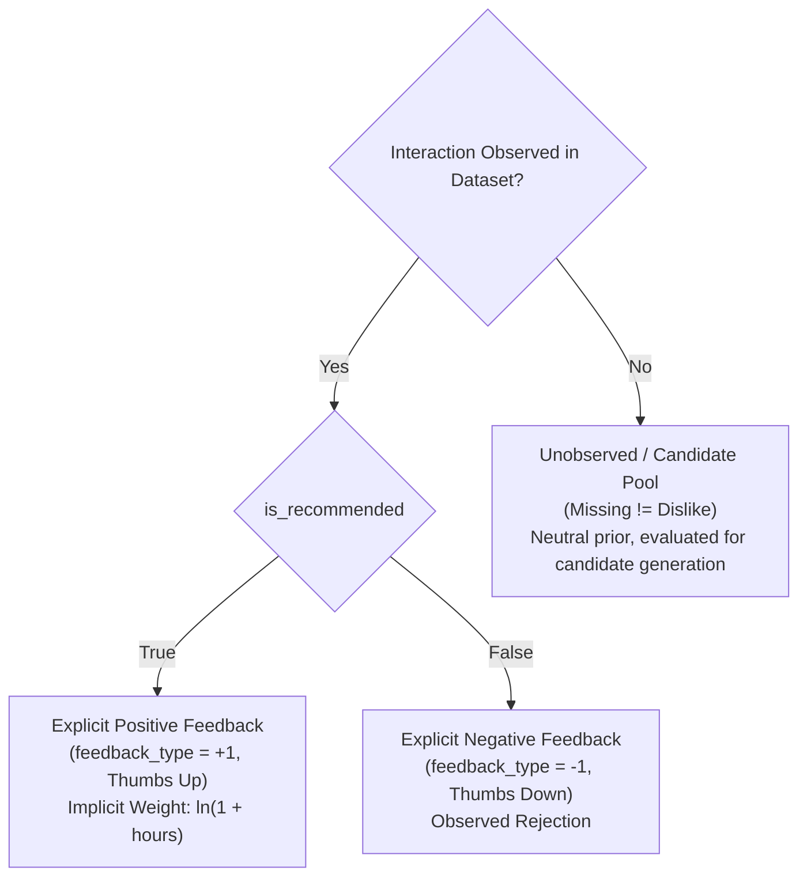

# GameRec: Data Quality & Preprocessing Report (Phase 2)

**Date**: 2026-10-13  
**Project**: GameRec — End-to-End Steam Game Recommendation Engine  
**Pipeline Version**: v0.1.0  
**Data Sources**: Steam games catalog, community metadata, and review interaction records (Anton Kozyriev, Kaggle)  
**Processed Artifacts**: `data/processed/games_catalog.parquet`, `data/processed/interactions_benchmark.parquet`, `data/processed/dataset_metrics.json`  

---

## 1. Executive Summary & Observed Dataset Dimensions

The Phase 2 preprocessing and exploratory data analysis pipeline was executed end-to-end without loading the entire 2 GB interaction dataset into uncompressed RAM or creating dense user–item matrices. All cleaning, deduplication, schema downcasting, Bayesian prior calculations, and active benchmark extractions were performed using streaming columnar operations.

### High-Level Metrics Summary (Real Observed Statistics)

| Metric | Raw Dataset | Processed Catalog / Clean Interactions |
| :--- | :--- | :--- |
| **Total Games in Catalog** | 50,872 (`games.csv`) | **50,872** (`games_catalog.parquet`) |
| **Catalog Metadata Records** | 50,872 (`games_metadata.json`) | **50,872** (100% 1:1 join on `app_id`) |
| **Total Review Interactions** | 41,154,794 (`recommendations.csv`) | **41,154,773** (Deduplicated; 21 pairs resolved) |
| **Active Benchmark Interactions** | — | **2,041,850** (`interactions_benchmark.parquet`) |
| **Unique Users with Reviews** | 13,781,059 | **13,781,059** (Benchmark: 99,997 active users) |
| **Unique Games with Reviews** | 37,610 | **37,610** (Benchmark: 8,599 active games) |
| **Catalog Games with 0 Reviews (Cold Start)** | — | **13,262 games (26.07% of catalog)** |
| **Orphan Review Games** | — | **0** (100% referential integrity with catalog) |
| **Interaction Matrix Sparsity** | — | **99.99206%** across raw interaction space |
| **Explicit Positive Feedback (`is_recommended=True`)** | 35,304,382 | **85.78%** |
| **Explicit Negative Feedback (`is_recommended=False`)** | 5,850,391 | **14.22%** |
| **Review Timestamps Span** | — | **2010-10-15 to 2022-12-31** (12.2 years) |

---

## 2. Repeated User–Game Interactions & Deduplication Strategy

### Inspection of Duplicates
Before selecting a deduplication rule, all records sharing identical `(user_id, app_id)` combinations in `recommendations.csv` were isolated and inspected:
* **Duplicate Interaction Pairs**: Exactly **21 user-game pairs** (51 total rows) across 41,154,794 rows.
* **Observed Pattern**: On Steam, users are permitted to edit or repost reviews over time (e.g., following a major game update, DLC release, or extended playtime). In some cases, a user's recommendation flipped (e.g., User `1085990` initially recommended App `1205960` as `True` on `2021-12-03`, then revised the verdict to `False` on `2021-12-04`).

### Deduplication Policy
* **Strategy**: Records are ordered deterministically by `(user_id, app_id, date, hours, review_id)` ascending, and `unique(subset=['user_id', 'app_id'], keep='last')` is applied.
* **Rationale**: The user's most recent interaction reflects their updated evaluation of the game and their cumulative recorded playtime.
* **Result**: Exactly 21 redundant records were removed, reducing total interactions from $41,154,794$ to $41,154,773$.

---

## 3. Feedback Semantics & Missing Data Principles

Recommendation systems risk critical bias when unobserved user-item pairs are conflated with dislikes. GameRec establishes a strict three-state feedback ontology:



1. **Explicit Positive Feedback (`feedback_type = 1`)**:
   - The user played the game and explicitly authored a positive review (`is_recommended == True`).
   - Represents **85.78%** of observed interactions.
   - Associated with an implicit confidence signal: $c_{ui} = \ln(1 + \text{hours})$.
2. **Explicit Negative Feedback (`feedback_type = -1`)**:
   - The user played the game and explicitly authored a negative review (`is_recommended == False`).
   - Represents **14.22%** of observed interactions.
   - Provides a verified rejection signal that can penalize candidate rank without fabricating artificial ratings.
3. **Missing / Unobserved Feedback**:
   - User has never reviewed the game.
   - **Crucial Rule**: Unobserved entries are **NEVER** imputed as $0$ or negative dislikes. They remain candidate recommendations whose predicted affinities are modeled via collaborative latent spaces and content similarity.

---

## 4. Join Coverage & Catalog Completeness

### Referential Integrity
* **Join Key**: Verified primary key `app_id` (`UInt32`).
* **Catalog $\to$ Metadata**: Exactly 50,872 games exist in `games.csv` and 50,872 JSON lines in `games_metadata.json`. Overlap is **100% (50,872 / 50,872)**.
* **Recommendations $\to$ Catalog**: All 37,610 unique games reviewed in `recommendations.csv` exist in `games_catalog.parquet` (**0 orphan games**).
* **Cold-Start Game Coverage**: **13,262 games (26.07% of the catalog)** have zero reviews in `recommendations.csv`.
  * *Architecture Consequence*: A pure collaborative filtering model fails completely for 26% of Steam games. The hybrid engine will automatically fall back to content-based similarity and Bayesian popularity priors for these unreviewed titles.

### Missingness in Catalog Fields
* **Game Descriptions**:
  * 40,499 games ($79.61\%$) have descriptions.
  * 10,373 games ($20.39\%$) have empty string descriptions `""`.
  * *Handling*: Handled safely with fallback `"No description provided."` and a boolean indicator flag `has_description = False`.
* **Community Tags**:
  * 49,628 games ($97.55\%$) possess community tags.
  * Only 1,244 games ($2.45\%$) have empty tag lists `[]`.
  * Total tag vocabulary size: **441 unique tags**.
  * *Handling*: Handled with `has_tags = False` indicator and fallback to title/developer tokens.

---

## 5. Interaction Degree Distribution & Matrix Sparsity

### Matrix Dimensions & Sparsity
* Unique Users: $13,781,059$
* Unique Games: $37,610$
* Possible Pairs: $|U| \times |I| = 13,781,059 \times 37,610 \approx 5.183 \times 10^{11}$
* Observed Interactions: $41,154,773$
* **Matrix Sparsity**: **99.99206%**

### User Degree Statistics (Reviews per User)
* **Min**: 1
* **25th Percentile**: 1.0
* **Median**: 1.0
* **Mean**: 2.99
* **75th Percentile**: 3.0
* **95th Percentile**: 9.0
* **Max**: 6,045
* **Power-Law Characteristic**: $55.0\%$ of users have authored only 1 review. Only $4.9\%$ of users have authored $\ge 10$ reviews.

### Game Degree Statistics (Reviews per Game)
* **Min**: 1
* **25th Percentile**: 13.0
* **Median**: 39.0
* **Mean**: 1,094.25
* **75th Percentile**: 180.0
* **95th Percentile**: 2,889.0
* **Max**: 319,491 (*Team Fortress 2*, App `440`)

---

## 6. Active Benchmark Dataset Extraction

To enable collaborative filtering training and offline ranking evaluation (Hit Rate@K, NDCG@K, Precision@K, MAP@K) without running out of RAM or encountering evaluation cold-start failure:
* **Filter Conditions**:
  * Minimum User Reviews: $\ge 10$
  * Minimum Game Reviews: $\ge 20$
  * Maximum Evaluated Users: $100,000$ (reproducible deterministic sample from 680,809 qualified users, seed 42)
* **Extracted Benchmark Statistics**:
  * **Total Interactions**: **2,041,850**
  * **Unique Users**: **99,997**
  * **Unique Games**: **8,599**
  * **File Size on Disk**: **24.22 MB** (`interactions_benchmark.parquet`, compressed with Zstandard).
* **Guarantees**:
  * Every user has at least 10 historical reviews, ensuring leak-free temporal train/val/test splits (e.g., leave-last-one-out or temporal cutoffs).
  * The interaction matrix fits comfortably in <150 MB of RAM during training.

---

## 7. Bayesian Rating Shrinkage Formulation

Raw positive review percentages (`positive_ratio`) suffer from sample size distortion: a game with $1$ positive review has $100\%$, ranking higher than *The Witcher 3* ($95\%$ on $668,000$ reviews).

GameRec implements an empirical Bayesian shrinkage estimator computed in `clean_games_catalog`:
$$W = \frac{v}{v + m} R + \frac{m}{v + m} C$$
Where:
* $R = \frac{\text{positive\_ratio}}{100}$ (Observed sample mean positive ratio).
* $v = \text{user\_reviews}$ (Total review volume).
* $C = \bar{R} \approx 0.7705$ (Global mean positive ratio across all 50,872 catalog games).
* $m = \text{Quantile}_{0.75}(v) = 206$ (Regularization threshold based on the 75th percentile of catalog review volumes).

This Bayesian score regularizes niche games with minimal review history toward the catalog mean while rewarding consistently rated high-volume titles.

---

## 8. Exploratory Data Analysis Visualizations

Six publication-quality figures were generated in `reports/figures/` using [scripts/run_eda.py](file:///Users/rhythmshokeen/Downloads/GameRec%20Engine/scripts/run_eda.py):

1. **[`01_game_popularity.png`](file:///Users/rhythmshokeen/Downloads/GameRec%20Engine/reports/figures/01_game_popularity.png)**:
   - Left: Log-log rank vs. review volume distribution demonstrating extreme power-law tail.
   - Right: Cumulative concentration curve showing that the top 5% of games account for ~88% of all reviews.
2. **[`02_top_tags.png`](file:///Users/rhythmshokeen/Downloads/GameRec%20Engine/reports/figures/02_top_tags.png)**:
   - Horizontal bar chart of the top 25 community tags (led by *Indie*, *Action*, *Adventure*, *Singleplayer*, *Casual*, and *Simulation*).
3. **[`03_user_activity.png`](file:///Users/rhythmshokeen/Downloads/GameRec%20Engine/reports/figures/03_user_activity.png)**:
   - Log-log histogram of user review counts illustrating heavy-tailed user engagement.
4. **[`04_sentiment_balance.png`](file:///Users/rhythmshokeen/Downloads/GameRec%20Engine/reports/figures/04_sentiment_balance.png)**:
   - Donut chart depicting 85.8% positive vs. 14.2% negative reviews.
   - Playtime comparison showing median playtime for positive reviews is significantly higher than negative reviews.
5. **[`05_playtime_distribution.png`](file:///Users/rhythmshokeen/Downloads/GameRec%20Engine/reports/figures/05_playtime_distribution.png)**:
   - Log-scale distribution of playtime hours with median indicator (27.3 hrs) and 1,000-hour scraper cap.
6. **[`06_missingness_summary.png`](file:///Users/rhythmshokeen/Downloads/GameRec%20Engine/reports/figures/06_missingness_summary.png)**:
   - Feature coverage breakdown confirming 97.5% tag availability, 79.6% description coverage, and 100% ID integrity.

---

## 9. Verification & Automated Test Suite

Automated validation checks were implemented in [tests/test_data.py](file:///Users/rhythmshokeen/Downloads/GameRec%20Engine/tests/test_data.py) and executed via `pytest`:
* **`test_default_paths`**: Verified filesystem path resolution for raw and processed datasets.
* **`test_clean_games_catalog`**: Verified ID typing (`UInt32`), tag concatenation, empty string handling, and Bayesian shrinkage range ($0.0 \le W \le 1.0$).
* **`test_interaction_deduplication`**: Verified that duplicate user-game pairs resolve strictly to the latest record.
* **`test_feedback_semantics`**: Verified $+1$ and $-1$ explicit feedback mapping and confidence score calculation.
* **`test_benchmark_k_core_filtering`**: Verified that minimum interaction constraints are enforced on users and items.

**Test Run Outcome**: 5/5 passed in **0.29s**.

---

## 10. Pipeline Execution & Reproducibility Guide

To reproduce Phase 2 preprocessing and EDA from scratch:

```bash
# 1. Activate isolated Python environment
source .venv/bin/activate

# 2. Run data cleaning, deduplication, and benchmark extraction
python scripts/run_preprocessing.py

# 3. Generate all EDA figures
python scripts/run_eda.py

# 4. Run automated test suite
python -m pytest tests/test_data.py -v
```
