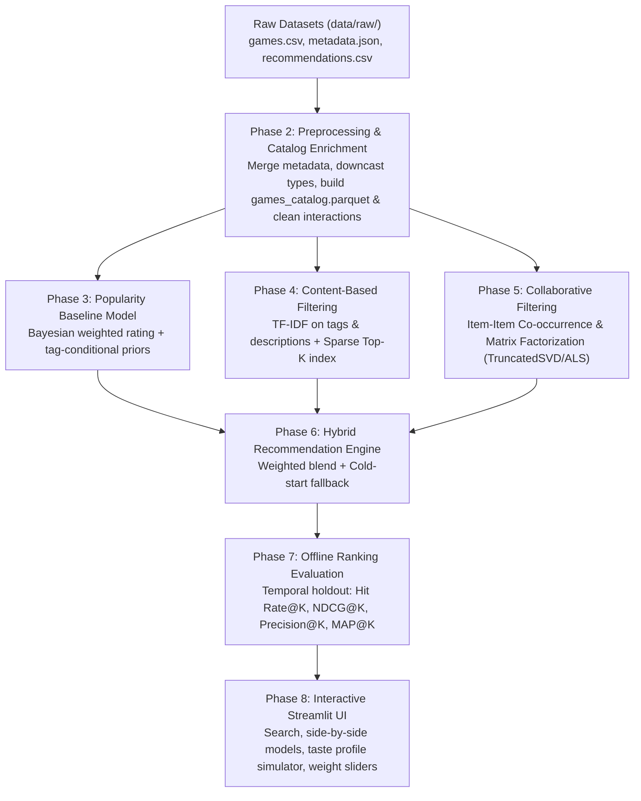

# GameRec: Project Status & Data Profiling Report (Phase 1)

**Date**: 2026-10-13  
**Project**: GameRec — End-to-End Steam Game Recommendation Engine  
**Author / Team**: ML Engineering & Recommendation Systems  
**Environment**: Python 3.11.9 on macOS (Apple M4, 16.0 GB Unified RAM)  

---

## 1. Executive Summary & Project Structure

The GameRec project is an end-to-end academic machine learning and recommendation systems platform built using the Kaggle Steam dataset created by Anton Kozyriev. Phase 1 focused on data archaeology, directory verification, schema profiling, referential integrity checks, leakage prevention analysis, environment configuration, and project planning.

### Existing Project Structure
```text
GameRec Engine/
├── .gitignore                      # Prevents committing datasets, models, caches, and .venv
├── .venv/                          # Reproducible isolated virtual environment (Python 3.11.9)
├── requirements.txt                # Pinned production and research dependencies
├── data/
│   └── raw/ -> ../dataset          # Verified symlink pointing to physical dataset files
├── dataset/                        # Authoritative raw dataset directory (CC0 license)
│   ├── games.csv                   # 4.64 MB (50,872 games)
│   ├── games_metadata.json         # 16.74 MB (50,872 JSON lines)
│   ├── recommendations.csv         # 1.93 GB (41,154,794 user interactions)
│   └── users.csv                   # 184.12 MB (14,306,064 user profiles)
├── reports/
│   ├── dataset_inspection.json     # Machine-readable profile of all files and metrics
│   └── PROJECT_STATUS.md           # This comprehensive status report
└── scripts/
    └── inspect_dataset.py          # Memory-efficient streaming verification script
```

---

## 2. Directory Comparison & Authoritative Data Source

### Directory Inode Audit (`dataset/` vs `data/raw/`)
Both directories were inspected to determine whether they represented redundant disk duplicates or divergent versions:

| File Name | `data/raw/` Size | `dataset/` Size | Inode Match | Physical Status |
| :--- | :--- | :--- | :--- | :--- |
| `games.csv` | 4.64 MB | 4.64 MB | `38170043 == 38170043` | Identical inode (Symlink) |
| `games_metadata.json` | 16.74 MB | 16.74 MB | `38170044 == 38170044` | Identical inode (Symlink) |
| `recommendations.csv` | 1,929.50 MB | 1,929.50 MB | `38170045 == 38170045` | Identical inode (Symlink) |
| `users.csv` | 184.12 MB | 184.12 MB | `38170058 == 38170058` | Identical inode (Symlink) |

**Decision**: `data/raw/` is a symlink referencing `/Users/rhythmshokeen/Downloads/GameRec Engine/dataset`. They point to the exact same physical disk blocks. `data/raw/` is adopted as the canonical project path in code to comply with standard data science directory conventions without duplicating 2.13 GB of storage.

---

## 3. Dataset Source & Licensing

* **Dataset Title**: Game Recommendations on Steam
* **Author / Curator**: Anton Kozyriev
* **Source Platform**: Kaggle ([Dataset URL](https://www.kaggle.com/datasets/antonkozyriev/game-recommendations-on-steam))
* **License**: **CC0: Public Domain** (Creative Commons Zero v1.0 Universal)
* **Data Origin**: Collected via Steam Store API and Steam Community user review endpoints (covering historical reviews up to December 31, 2022).

---

## 4. Schemas, Data Types, Missing Values & Memory Requirements

### A. `games.csv`
* **File Size**: 4.64 MB | **Row Count**: 50,872 | **Column Count**: 13
* **Primary Key**: `app_id` (Int64, 50,872 unique records, 0 nulls)
* **Columns & Types**:
  * `app_id` (`Int64`): Steam Application ID
  * `title` (`String`): Game title (50,751 distinct, 0 nulls, 0 empty strings)
  * `date_release` (`String`): Release date (`YYYY-MM-DD`, range: `1997-06-30` to `2023-01-24`, 0 nulls)
  * `win`, `mac`, `linux` (`Boolean`): OS platform availability (0 nulls)
  * `rating` (`String`): Qualitative sentiment category (e.g., *Positive*, *Very Positive*, *Mixed*, *Overwhelmingly Positive*, 0 nulls)
  * `positive_ratio` (`Int64`): Percentage of positive reviews ($0 - 100\%$, mean: $77.05\%$, 0 nulls)
  * `user_reviews` (`Int64`): Total Steam review volume (min: 10, median: 49, mean: 1,824, max: 7,494,460, 0 nulls)
  * `price_final` / `price_original` (`Float64`): Store price in USD (min: $0.00, median: $4.99, max: $299.99, 0 nulls)
  * `discount` (`Float64`): Discount percentage ($0.0 - 90.0\%$, 0 nulls)
  * `steam_deck` (`Boolean`): Steam Deck verification badge (0 nulls)
* **In-Memory Size**: ~4.4 MB (Polars) / ~8.5 MB (Pandas). Easily fits in RAM.

### B. `games_metadata.json`
* **File Size**: 16.74 MB | **Line Count**: 50,872 (JSON Lines format)
* **Keys**:
  * `app_id` (`int`): Exact 1:1 match with all 50,872 games in `games.csv` (100% overlap).
  * `description` (`str`): Text description/blurb. **10,373 records (20.39%) are empty strings**.
  * `tags` (`list[str]`): Community tags. **1,244 records (2.45%) are empty lists**. Tag vocabulary contains **441 unique tags**.
* **In-Memory Size**: ~18 MB parsed.

### C. `users.csv`
* **File Size**: 184.12 MB | **Row Count**: 14,306,064 | **Column Count**: 3
* **Primary Key**: `user_id` (`Int64`, 14,306,064 unique, 0 nulls)
* **Columns & Types**:
  * `user_id` (`Int64`): Unique user ID
  * `products` (`Int64`): Number of games owned (min: 0, median: 55, mean: 116.4, max: 32,214, 0 nulls)
  * `reviews` (`Int64`): Number of reviews written (min: 0, median: 1, mean: 2.88, max: 6,045, 0 nulls)
* **In-Memory Size**: ~110 MB in Polars, ~343 MB in Pandas.

### D. `recommendations.csv`
* **File Size**: 1,929.50 MB (~1.93 GB) | **Row Count**: **41,154,794** | **Column Count**: 8
* **Columns & Types**:
  * `app_id` (`Int64`): Steam Application ID (37,610 unique, 0 nulls)
  * `helpful` (`Int64`): Helpful votes received (max: 39,261, 0 nulls)
  * `funny` (`Int64`): Funny votes received (max: 27,088, 0 nulls)
  * `date` (`String`): Date review posted (`YYYY-MM-DD`, range: `2010-10-15` to `2022-12-31`, 0 nulls)
  * `is_recommended` (`Boolean`): Thumbs up/down binary rating (**85.78% True**, 14.22% False, 0 nulls)
  * `hours` (`Float64`): Recorded playtime at review time (min: 0.0, median: 27.3, mean: 100.6, 95th percentile: 517.4, max: 1,000.0 [capped], 0 nulls)
  * `user_id` (`Int64`): Steam user identifier (13,781,059 unique, 0 nulls)
  * `review_id` (`Int64`): Review identifier (41,154,794 unique, 0 nulls)
* **In-Memory Size**:
  * Naive 64-bit Pandas load: **~3.8 - 4.5 GB RAM**.
  * Dense User-Item Matrix ($13.78\text{M} \times 37.6\text{K} \times 4\text{ bytes}$): **~2.07 Terabytes** (Impossible).
  * Downcasted Parquet (uint32 IDs, float32 hours, bool): **~650 MB** on disk, zero-copy streaming.

---

## 5. Join Key Verification & Catalog Coverage

1. **Games to Recommendations Join Key**:
   * Join Key: `app_id` (`Int64`).
   * Orphan reviews: **0** (All 37,610 games appearing in `recommendations.csv` exist in `games.csv`).
   * Catalog unreviewed games (**Cold-Start Games**): **13,262 games (26.07%)** have zero reviews in `recommendations.csv`. These require Content-Based and Popularity fallback.
2. **Users to Recommendations Join Key**:
   * Join Key: `user_id` (`Int64`).
   * 13,781,059 of the 14,306,064 users in `users.csv` have at least 1 review in `recommendations.csv`.

---

## 6. Required Fields Availability Matrix

| Field | Required by Spec | Status | Source Location | Notes |
| :--- | :--- | :--- | :--- | :--- |
| **Descriptions** | Yes | **Available** | `games_metadata.json` (`description`) | 20.39% empty; fallback to tags/title |
| **Genres / Tags** | Yes | **Available** | `games_metadata.json` (`tags`) | 441 community tags; 97.55% coverage |
| **Ratings** | Yes | **Available** | `games.csv` (`rating`, `positive_ratio`, `user_reviews`) | Rich aggregate sentiment |
| **Pos / Neg Recs** | Yes | **Available** | `recommendations.csv` (`is_recommended`) | 85.78% True, 14.22% False |
| **User IDs** | Yes | **Available** | `recommendations.csv` / `users.csv` (`user_id`) | 13.78M unique active users |
| **Playtime** | Yes | **Available** | `recommendations.csv` (`hours`) | Continuous implicit feedback (capped at 1000h) |
| **Timestamps** | Yes | **Available** | `recommendations.csv` (`date`) & `games.csv` (`date_release`) | 2010 to 2022 review timestamps |

---

## 7. Data Quality, Hygiene & Leakage Risk Assessment

1. **Duplicate Records**:
   * Exact `review_id` duplicates: **0** (All 41,154,794 are unique).
   * Multi-interaction pairs `(user_id, app_id)`: **Only 21 pairs** out of 41.15 million. Resolved by retaining the latest interaction or max playtime.
2. **Extreme Sparsity & Power-Law Distribution**:
   * Users with 1 review: **7,573,027 (55.0%)**.
   * Users with 2–4 reviews: **4,297,201 (31.2%)**.
   * Users with $\ge 5$ reviews: **1,910,831 (13.9%)** (22.4M interactions).
   * Users with $\ge 10$ reviews: **680,812 (4.9%)** (14.6M interactions).
   * *Implication*: Collaborative filtering training and ranking metric evaluation must be conducted on an active-user benchmark subset (e.g. $k$-core with $k \ge 10$) so that users have sufficient interaction history for valid train/test holdouts.
3. **Severe Class Imbalance**:
   * $85.78\%$ positive reviews. Treat implicit feedback (`hours` played weighted as $\log(1 + \text{hours})$) as confidence, rather than treating thumbs-down as random negatives.
4. **Data Leakage Risks & Safeguards**:
   * **Temporal Leakage**: Standard random splits leak future preferences to past interactions. **Safeguard**: Implement temporal holdout (splitting by interaction date or holding out each user's latest review).
   * **Social Meta-Feedback Leakage**: Columns `helpful` and `funny` accumulate over years after a review is posted. **Safeguard**: Exclude `helpful` and `funny` from recommendation models.
   * **Target Leakage via Playtime**: Total playtime `hours` is recorded at the review timestamp. **Safeguard**: Use $\log(1 + \text{hours})$ purely as an implicit interaction confidence weight, not as a supervised target feature.

---

## 8. Reproducible Environment & Configuration

* **Python Version**: Detected `Python 3.11.9` on host macOS (Apple Silicon M4).
* **Virtual Environment**: Initialized at `.venv/`.
* **Dependencies (`requirements.txt`)**: Pinned versions for `polars`, `pyarrow`, `pandas`, `numpy`, `scipy`, `scikit-learn`, `streamlit`, `matplotlib`, and `pytest`.
* **Repository Safeguards (`.gitignore`)**: Configured to ignore `data/raw/`, `dataset/`, `data/processed/`, `*.parquet`, `*.csv`, `models/*.pkl`, `.venv/`, `__pycache__/`, `.DS_Store`, and `.streamlit/secrets.toml`.

---

## 9. Comprehensive Project Implementation Plan



### Detailed Phase Milestones:
* **Phase 1 (Completed)**: Dataset archaeology, schema verification, license, leakage audit, reproducible environment, and status report.
* **Phase 2: Preprocessing & Catalog Enrichment**:
  * Build memory-efficient Polars preprocessing pipeline.
  * Combine `games.csv` and `games_metadata.json` into `data/processed/games_catalog.parquet`.
  * Create filtered $k$-core interaction benchmark (`data/processed/interactions_benchmark.parquet`) for CF training and offline evaluation.
* **Phase 3: Popularity Baseline Model**:
  * Implement Bayesian weighted rating:
    $$W = \frac{v}{v + m} R + \frac{m}{v + m} C$$
  * Implement tag-filtered popularity and release-year popularity filters.
* **Phase 4: Content-Based Recommender**:
  * Vectorize tags (weighted $3\times$) and descriptions with TF-IDF.
  * Extract precomputed Top-100 nearest neighbors per game stored as a compact lookup table (~18 MB), ensuring $<1$ ms inference latency in the UI.
* **Phase 5: Collaborative Filtering**:
  * Sparse Item-Item Cosine / BM25 similarity matrix.
  * Latent Factor Matrix Factorization (TruncatedSVD / Implicit Alternating Least Squares) with confidence weighting $\log(1 + \text{hours})$.
* **Phase 6: Hybrid Engine**:
  * Dynamic weighted scoring:
    $$\text{Score}(u, i) = \alpha \cdot \text{Score}_{\text{CF}} + \beta \cdot \text{Score}_{\text{Content}} + \gamma \cdot \text{Score}_{\text{Pop}}$$
  * Graceful fallback to Content + Popularity for cold-start games ($26\%$ of catalog) and new users.
* **Phase 7: Evaluation Framework**:
  * Temporal holdout evaluation across test users.
  * Measure and report real: Hit Rate@10, NDCG@10, Precision@10, Recall@10, MAP@10.
* **Phase 8: Streamlit Application**:
  * Multi-page/multi-tab rich interactive UI with game search, comparative recommendation grids, interactive sliders, and evaluation charts.

---

## 10. Completed Milestones & Next Steps

* **Phase 1 (Completed)**: Dataset archaeology, schema verification, CC0 license documentation, referential integrity audit, leakage safeguards, and reproducible environment (.venv, requirements.txt, .gitignore).
* **Phase 2 (Completed)**: Preprocessing pipeline, schema downcasting, deduplication, catalog unification (`data/processed/games_catalog.parquet`), active 10-core benchmark extraction (`interactions_benchmark.parquet`), dataset metrics, and 6 publication-ready EDA figures (`reports/figures/`).
* **Phase 3 (Completed)**:
  - Model A: Popularity Baseline with Bayesian shrinkage rating ($W$) and weighted popularity index ($\text{PopScore}$). Supports global, tag/genre-specific, and platform filtering with full metadata explanations.
  - Model B: Content-Based Filtering with multi-modal TF-IDF sparse matrix ($X_{\text{combined}}$). Supports single-game similarity, weighted multi-game user taste profile recommendations, exclusions, and factual shared-tag explanations.
  - Tested with 17 passing automated unit and regression tests in `tests/test_models.py` and `tests/test_data.py`.
  - Artifacts persisted: `models/popularity_model.joblib` and `models/content_model.joblib`.
* **Exact Next Step (Phase 4)**: Implement **Collaborative Filtering** (Sparse Item-Item Co-occurrence & Matrix Factorization / TruncatedSVD on the active benchmark), construct the **Hybrid Recommendation Model**, and perform **Offline Ranking Evaluation** (Hit Rate@K, NDCG@K, Precision@K, MAP@K).

